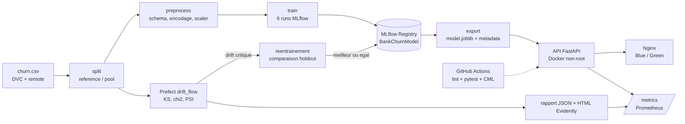

# Bank Churn MLOps — plateforme de prédiction d'attrition client bancaire

[](https://github.com/kaouech-rahim/Bank-Churn-MLOps/actions/workflows/ci.yml)


Projet de fin de module « MLOps & Industrialisation de l'IA » — trinôme :
**Amir Rjeb** (données, DVC, drift), **AbdRahim Kaouech** (modèles, MLflow, Prefect),
**Fatma Ayadi** (API, Docker, CI/CD, Prometheus).


---

## 1. Problème et objectifs

Une banque veut repérer à l'avance les clients qui risquent de fermer leur compte afin
de leur proposer une action de fidélisation. Le modèle prédit `Exited` (1 = le client
part) à partir de 10 variables (score de crédit, pays, âge, solde, produits…).

| | |
|---|---|
| Données | `churn.csv` (Kaggle), 10 000 clients, 20,4 % de churn |
| Consigne du professeur | 5 000 lignes pour l'entraînement (`churn_reference.csv`), 5 000 lignes pour simuler la production et le drift (`churn_production_pool.csv`) |
| KPI (SYNOPSIS) | F1 ≥ 0,60 · ROC-AUC ≥ 0,85 · rappel ≥ 0,70 · latence < 150 ms |

**Résultats obtenus** (jeu de test de 1 000 clients, seuil 0,5) — champion
`RandomForest-Tuned` : ROC-AUC **0,868**, F1 **0,634**, précision 0,582,
rappel **0,696** (juste sous l'objectif de 0,70), latence p95 **47 ms** (mesure locale).
Détails : [docs/RAPPORT.md](docs/RAPPORT.md). Guide détaillé des données et du remote DVC : [docs/GUIDE_DONNEES_DVC.md](docs/GUIDE_DONNEES_DVC.md).

---

## 2. Architecture



| Pilier du guide | Réalisation | Fichiers |
|---|---|---|
| 1. Craftsmanship | Code sous `src/`, typage, docstrings Google, black / isort / flake8 / mypy | `src/`, `pyproject.toml`, `.flake8`, `.pre-commit-config.yaml` |
| 2. DVC | Pipeline `split → preprocess → train`, remote déclaré | `dvc.yaml`, `dvc.lock`, `.dvc/config` |
| 3. MLflow | 6 runs (LogReg, RandomForest, XGBoost × baseline/tuned), Registry Staging → Production | `src/models/` |
| 4. Serving | FastAPI `/predict`, `/predict/batch`, `/health`, `/info`, `/metrics` ; Docker multi-stage non-root | `src/api/`, `Dockerfile`, `docker-compose.yml` |
| 5. CI/CD & CML | GitHub Actions : lint + pytest (≥ 75 %) + build Docker + rapport CML sur PR | `.github/workflows/ci.yml`, `scripts/cml_report.py` |
| 6. Prefect | 2 flows en DAG avec retries, work pool `churn-pool`, CRON, Blue/Green | `pipelines/`, `prefect.yaml`, `scripts/switch_traffic.py` |
| 7. Drift & réentraînement | KS, χ², PSI, rapport Evidently, Prometheus + alerte, réentraînement automatique | `src/monitoring/`, `pipelines/drift_flow.py`, `prometheus/` |

Arborescence utile :

```
configs/config.yaml        configuration centrale (chemins, seuils, hyperparamètres)
src/data, src/features     ingestion, découpage, validation, encodage
src/models                 entraînement MLflow, évaluation, Registry, client d'inférence
src/api                    API FastAPI (schémas Pydantic v2, ModelService)
src/monitoring             drift (KS/chi2/PSI), simulateur, dashboard, métriques Prometheus
pipelines                  flows Prefect (entraînement, drift + réentraînement)
scripts                    rapport CML, bascule Blue/Green, trafic de démonstration
deploy, prometheus         Nginx, modèles par couleur, configuration Prometheus
tests                      154 tests pytest (données synthétiques, sans réseau)
docs                       rapport, démo, soutenance, checklist
```

---

## 3. Installation

Prérequis : **Python 3.11 ou 3.12**, Poetry, Git. Docker Desktop pour la partie
conteneurs. Dans PowerShell, à la racine du dépôt :

```powershell
poetry config virtualenvs.in-project true   # une seule fois
poetry install                              # crée .venv et installe tout
$env:PYTHONIOENCODING = "utf-8"             # évite les erreurs d'affichage Prefect/MLflow
$env:MLFLOW_DISABLE_AGENT_HINT = "1"        # masque un message d'information de MLflow
```

Reproduction en 3 commandes (règle d'or du guide) :

```powershell
git clone https://github.com/kaouech-rahim/Bank-Churn-MLOps.git; cd Bank-Churn-MLOps
poetry install; poetry run dvc pull       # nécessite l'accès au remote DVC (voir §7)
poetry run pytest                         # les tests n'ont besoin ni de DVC ni du réseau
```

> **Postes avec Windows Smart App Control** : certaines DLL fraîchement installées
> peuvent être bloquées au premier chargement (« Une stratégie de contrôle d'application
> a bloqué ce fichier »). Relancer la commande suffit en général ; `asyncpg` est épinglé
> en 0.30.0 pour cette raison. Si `flake8.exe` est bloqué, utiliser
> `poetry run python -m flake8`.

---

## 4. Lancer chaque composant (PowerShell)

### 4.1 Données et pipeline DVC
```powershell
poetry run dvc repro          # split -> preprocess -> train (seules les étapes modifiées)
poetry run dvc status         # "Data and pipelines are up to date."
poetry run dvc metrics show   # métriques des 6 runs (reports/metrics.json)
```

### 4.2 MLflow (TP3)
```powershell
# Terminal 1 : serveur (backend SQLite obligatoire pour le Registry)
poetry run mlflow server --backend-store-uri sqlite:///mlflow.db --default-artifact-root ./mlruns --host 127.0.0.1 --port 5000
# Terminal 2 : entraînement + Registry + export, puis inférence depuis le Registry
poetry run python -m src.models.train --config configs/config.yaml
poetry run python -m src.models.predict_production --config configs/config.yaml
```
Interface : http://127.0.0.1:5000 (expérience `Bank-Churn`, modèle `BankChurnModel`).

### 4.3 API FastAPI (TP4)
```powershell
poetry run uvicorn src.api.main:app --host 127.0.0.1 --port 8000
```
Swagger : http://127.0.0.1:8000/docs. Exemple :
```powershell
$body = '{"CreditScore":619,"Geography":"Germany","Gender":"Female","Age":58,"Tenure":2,"Balance":125000,"NumOfProducts":1,"HasCrCard":1,"IsActiveMember":0,"EstimatedSalary":101348.88}'
Invoke-RestMethod -Method Post -Uri http://127.0.0.1:8000/predict -ContentType "application/json" -Body $body
```

### 4.4 Docker, Blue/Green et Prometheus
```powershell
poetry run python scripts/switch_traffic.py --init   # copie models/ vers blue et green
docker compose up -d --build                         # api_blue, api_green, nginx, prometheus
Invoke-RestMethod http://localhost:8000/health       # passe par Nginx -> blue
# Démonstration de bascule : terminal 1
poetry run python scripts/traffic_during_switch.py --duration 60
# terminal 2 (après un réentraînement qui a mis à jour models/)
poetry run python scripts/switch_traffic.py
poetry run python scripts/switch_traffic.py --rollback   # retour arrière si besoin
```
Prometheus : http://localhost:9090 (alerte `DataDriftCritical` dans l'onglet *Alerts*).

### 4.5 Prefect 3 (orchestration)
```powershell
# Terminal 1
poetry run prefect server start
# Terminal 2
$env:PREFECT_API_URL = "http://127.0.0.1:4200/api"
poetry run prefect work-pool create churn-pool --type process
$env:PROJECT_DIR = (Get-Location).Path
poetry run prefect --no-prompt deploy --all
poetry run prefect worker start --pool churn-pool
# Terminal 3 : lancer un run sans attendre le CRON
poetry run prefect deployment run "bank-churn-drift-monitoring/drift-daily"
```
Exécution directe (sans serveur) : `poetry run python -m pipelines.drift_flow --scenario strong`.

### 4.6 Tests et qualité
```powershell
poetry run pytest --cov=src --cov=pipelines --cov-report=term-missing
poetry run python -m flake8 src tests pipelines scripts
poetry run black --check src tests pipelines scripts
poetry run isort --check-only src tests pipelines scripts
poetry run mypy src pipelines scripts
```

---

## 5. Règles de décision (toutes dans `configs/config.yaml`)

| Règle | Valeur |
|---|---|
| Champion | meilleur ROC-AUC parmi les 6 runs (le premier en cas d'égalité) |
| Seuil de décision churn | probabilité ≥ 0,5 |
| Niveau de risque API | Faible < 0,35 ≤ Modéré < 0,70 ≤ Élevé |
| Variable en drift | test KS/χ² significatif (p < 0,05) **et** PSI ≥ 0,10 |
| Drift critique | ≥ 30 % des 8 variables surveillées (3 variables ou plus) |
| Promotion d'un nouveau champion | comparé au modèle en service sur les mêmes clients : promu seulement si ROC-AUC ≥ ROC-AUC actuel + `min_improvement` (0,0) **et** rappel au seuil 0,5 ≥ rappel actuel − `max_recall_drop` (0,0) |
| Refus de promotion | métrique absente ou non finie, modèle en service illisible, ou bundle `models/` manquant alors qu'une version est en Production : `models/` n'est pas modifié ; la nouvelle version reste en Staging (entraînement planifié) ou n'est pas ajoutée au Registry, mais ses runs et artefacts MLflow sont conservés (après drift) |
| Clients de comparaison | entraînement planifié : 1 000 clients de test de la référence ; après drift : hold-out de production jamais vu par les deux modèles |

---

## 6. Résultats et limites

Les 6 runs, la boucle de drift et la latence ont été exécutés sur les vraies données :
voir [docs/RAPPORT.md](docs/RAPPORT.md) et la checklist [docs/CHECKLIST.md](docs/CHECKLIST.md).

Limites connues :
- rappel du champion 0,696 < 0,70 au seuil 0,5 ; baisser le seuil se règlerait sur un jeu
  de validation dédié (non fait pour ne pas optimiser sur le jeu de test) ;
- le drift est **simulé** ; les labels du pool sont réels mais conservés après la
  transformation artificielle des variables (approximation de simulation) ;
- Docker, Nginx Blue/Green et Prometheus ont été exécutés (bascule v3 → v4 sans erreur sur
  496 requêtes) ; la CI et le rapport CML ont tourné avec succès sur la PR #7.

---

## 7. Remote DVC

`.dvc/config` (versionné) déclare actuellement le remote `storage` vers
`C:\Users\Fatma Ayadi\Downloads\dvc`, un chemin propre à un seul poste et **absent**
sur celui-ci : un coéquipier ne peut donc pas faire `dvc pull`. Le remote S3 décrit
dans le SYNOPSIS (`s3://mlops-project-ftima`, profil AWS `dvc`) n'y figure plus.
À décider en équipe, par exemple :

```powershell
poetry run dvc remote add -d -f storage s3://mlops-project-ftima
poetry run dvc remote modify storage profile dvc
aws configure --profile dvc        # identifiants donnés par la propriétaire du bucket
poetry run dvc push
```
Un remote local personnel doit aller dans `.dvc/config.local` (`dvc remote add --local …`),
ignoré par Git. Ne jamais committer d'identifiants.

---

## 8. Dépannage (Windows)

| Message | Solution |
|---|---|
| `DLL load failed … stratégie de contrôle d'application` | Relancer ; Smart App Control vérifie la DLL au premier chargement |
| `UnicodeEncodeError: 'charmap'` (Prefect) | `$env:PYTHONIOENCODING = "utf-8"` |
| `&&` n'est pas un séparateur valide | Utiliser `;` dans PowerShell 5.1 |
| Port 8000 / 5000 / 4200 occupé | `netstat -ano \| findstr :8000` puis `taskkill /PID <pid> /F` |
| `database is locked` (MLflow) | Un seul entraînement à la fois sur `mlflow.db` |
