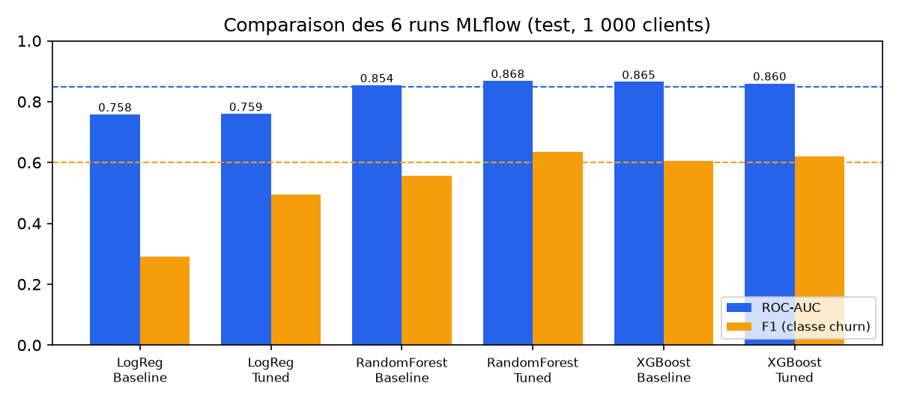
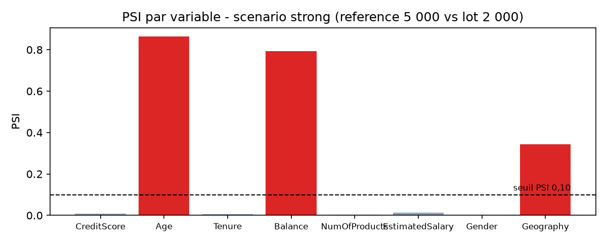

# Plateforme MLOps de prédiction d'attrition client bancaire

**Projet de fin de module — MLOps & Industrialisation de l'IA (2026–2027)**
Enseignant : Haythem Ghazouani · Trinôme : **Amir Rjeb**, **AbdRahim Kaouech**, **Fatma Ayadi**
Dépôt : `https://github.com/kaouech-rahim/Bank-Churn-MLOps` · Version du rapport : octobre 2026

Tous les chiffres de ce rapport proviennent d'exécutions réelles sur le poste de
développement (Windows 11, Python 3.12, Docker Desktop) ou sur GitHub Actions. Les encadrés orange indiquent les captures
d'écran que le groupe doit encore ajouter.

## 1. Problématique métier et objectifs

Dans une banque, conquérir un nouveau client coûte nettement plus cher que d'en garder un.
L'objectif est donc d'identifier à l'avance les clients susceptibles de fermer leur compte
afin que le conseiller leur propose une action de fidélisation. Le modèle prédit la variable
`Exited` (1 = le client part) ; si la probabilité dépasse le seuil de décision, le client est
ajouté à la liste de fidélisation et l'API indique un niveau de risque (Faible, Modéré, Élevé).

Les objectifs fixés dans le `SYNOPSIS.md` sont : **F1 ≥ 0,60**, **ROC-AUC ≥ 0,85**,
**rappel ≥ 0,70** sur la classe churn, et une **latence d'inférence < 150 ms**.
Au-delà du score, le guide impose une plateforme reproductible, testée, conteneurisée,
orchestrée et capable de surveiller sa propre dérive. Notre groupe de trois couvre le
périmètre « trinôme » : tronc commun, Prefect (work pool + CRON), rapport CML, simulateur de
dérive, déploiement Blue/Green, dashboard Evidently et export Prometheus.

## 2. Données et pipeline reproductible (DVC)

Le jeu `churn.csv` (Kaggle, « Churn for bank customers ») contient **10 000 clients** et
14 colonnes, avec **20,4 % de churn**. Il respecte les critères du guide : 6 variables
numériques (`CreditScore`, `Age`, `Tenure`, `Balance`, `NumOfProducts`, `EstimatedSalary`),
2 catégorielles (`Geography`, `Gender`), 2 binaires et une cible métier explicite.
Les colonnes `RowNumber`, `CustomerId` et `Surname` sont supprimées.

Conformément à la consigne du professeur, le pipeline DVC sépare les données en deux :

| Étape DVC | Commande | Sorties |
|---|---|---|
| `split` | `python -m src.data.split_data` | `churn_reference.csv` (5 000 lignes, entraînement) et `churn_production_pool.csv` (5 000 lignes, flux de production), découpage stratifié |
| `preprocess` | `python -m src.features.preprocess` | validation du schéma, split train/test 80/20 (4 000 / 1 000), encodage binaire et One-Hot, min-max appris **sur le train seulement** → `train.csv`, `test.csv`, `scaler_params.json` |
| `train` | `python -m src.models.train` | 6 runs MLflow, champion → Registry → `models/model.joblib`, `metadata.json`, `reports/metrics.json` |

Le contrat de données (modalités autorisées, bornes de chaque variable) est centralisé dans
`configs/config.yaml` et vérifié par `validate_schema()`. Tous les chemins, seuils et
hyperparamètres sont dans ce fichier. La commande `dvc repro` a été exécutée : `split` et
`preprocess` étaient à jour (non relancés) et seule l'étape `train` s'est exécutée.
Les empreintes SHA-256 des fichiers de données ont été vérifiées avant et après chaque
phase : aucune source n'a été modifiée.

**Point d'attention :** le remote versionné dans `.dvc/config` pointe vers un dossier local
d'un seul poste (absent sur le poste de test). Le remote S3 prévu (`s3://mlops-project-ftima`)
doit être rétabli avant la remise pour que `dvc pull` fonctionne chez tous les membres.

## 3. Architecture MLOps

Le code est organisé en paquets : `src/data`, `src/features`, `src/models`, `src/api`,
`src/monitoring`, les flows Prefect dans `pipelines/` et les outils dans `scripts/`.
Chaque fonction a des annotations de type et une docstring ; `flake8`, `black`, `isort` et
`mypy` passent sans erreur sur `src`, `tests`, `pipelines` et `scripts`.

## 4. Expérimentation et gouvernance avec MLflow

Le tracking suit le TP3 : backend **SQLite** (`sqlite:///mlflow.db`, indispensable pour le
Registry), artefacts dans `./mlruns`, serveur sur le port 5000. Trois algorithmes sont
comparés, chacun avec une configuration *baseline* et une configuration *tuned* définies dans
la configuration (pondération des classes pour les versions tuned). Chaque run enregistre les
hyperparamètres, cinq métriques, des tags, la matrice de confusion et la courbe ROC (PNG),
la signature du modèle et un exemple d'entrée.

| Run (test : 1 000 clients, seuil 0,5) | Accuracy | Précision | Rappel | F1 | ROC-AUC |
|---|---|---|---|---|---|
| LogReg-Baseline | 0,804 | 0,556 | 0,196 | 0,290 | 0,758 |
| LogReg-Tuned | 0,703 | 0,379 | 0,711 | 0,494 | 0,760 |
| RandomForest-Baseline | 0,864 | 0,833 | 0,417 | 0,556 | 0,854 |
| **RandomForest-Tuned (champion)** | 0,836 | 0,582 | **0,696** | **0,634** | **0,868** |
| XGBoost-Baseline | 0,869 | 0,783 | 0,495 | 0,607 | 0,865 |
| XGBoost-Tuned | 0,828 | 0,565 | 0,686 | 0,620 | 0,860 |

**Règle du champion :** meilleur ROC-AUC (`models.champion_metric`), car il évalue le
classement indépendamment du seuil. Le champion `RandomForest-Tuned` est enregistré sous
`BankChurnModel`, passe en **Staging** avec une description QA, puis en **Production** avec
archivage automatique des versions précédentes (`archive_existing_versions=True`). MLflow 3.17
dépréciant les *stages*, l'alias `champion` est posé en complément. Le client
`predict_production.py` charge bien `models:/BankChurnModel/Production` (exécuté).

**Bilan des KPI :** ROC-AUC 0,868 (objectif ≥ 0,85 atteint), F1 0,634 (≥ 0,60 atteint),
rappel 0,696 : **objectif de 0,70 manqué de peu** (142 départs détectés sur 204,
62 manqués, 102 fausses alertes). En abaissant le seuil à 0,45, le rappel atteindrait 0,750
(F1 0,622) sur le test ; nous ne l'avons pas fait, car régler le seuil sur le jeu de test
biaiserait l'évaluation. Il faudrait un jeu de validation dédié. Les variables les plus
importantes pour la forêt sont l'âge (0,36), le nombre de produits (0,17) et le solde (0,11).

📸 <b>Capture à ajouter — MLflow</b> : page <i>Compare</i> des 6 runs et
onglet <i>Models</i> montrant les versions de <code>BankChurnModel</code> (Production / Archived).
Prouve : tracking des runs et promotion formelle.

## 5. Microservice d'inférence et conteneurisation

L'API FastAPI reprend l'architecture du TP4 : une classe `ModelService` (méthodes `load`,
`is_ready`, `predict_single`, `predict_batch`) chargée une seule fois par le `lifespan`, et des
schémas **Pydantic v2** (`Literal` pour `Geography` et `Gender`, bornes `ge`/`le` identiques au
contrat de données, synchronisation vérifiée par un test). Le prétraitement n'est pas réécrit :
l'API appelle `encode_features()` avec le `scaler_params.json` livré avec le modèle.

| Endpoint | Rôle | Comportement vérifié |
|---|---|---|
| `GET /health` | sonde Docker | 200 si le modèle est chargé, **503** sinon |
| `GET /info` | gouvernance | version Registry, algorithme, métriques, features |
| `POST /predict` | prédiction unitaire | `churn`, `churn_probability`, `risk_tier`, `model_version` ; **422** si pays inconnu, borne dépassée, champ manquant |
| `POST /predict/batch` | lot vectorisé | 1 à 1 000 clients, probabilité moyenne ; 0 ou 1 001 clients → 422 |
| `GET /metrics` | Prometheus | compteurs, histogramme de latence, version, drift |

Mesure réelle avec uvicorn sur le poste (200 requêtes HTTP `/predict` successives) :
**p50 = 27,7 ms, p95 = 47,2 ms, max = 61,8 ms**, sous l'objectif de 150 ms.

Le `Dockerfile` est **multi-stage** (`python:3.11-slim` ; l'étape *builder* crée un
environnement virtuel, l'étape finale ne copie que celui-ci), exécuté sous l'utilisateur
non-root **`appuser` (UID 1000)** avec un `HEALTHCHECK` en Python pur (pas de `curl` à
installer). `requirements.txt` reprend les versions exactes du `poetry.lock` et utilise
`xgboost-cpu` pour éviter plusieurs centaines de Mo de bibliothèques CUDA inutiles. Aucune
donnée ni aucun secret n'est copié (`.dockerignore`). La résolution des dépendances pour
Linux / Python 3.11 a été vérifiée, puis l'image a été construite et lancée avec Docker
Desktop : `api_blue` et `api_green` démarrent, chargent le modèle et répondent derrière Nginx.
Le job CI `docker` reconstruit l'image et vérifie l'UID 1000 à chaque Pull Request.

📸 <b>Captures à ajouter — API</b> : Swagger <code>/docs</code> avec une
réponse 200 et une réponse 422 ; <code>docker compose ps</code> montrant les conteneurs
<i>healthy</i> ; <code>docker images</code> (taille de l'image).

## 6. Intégration continue et rapport CML

Le workflow `.github/workflows/ci.yml` comporte trois jobs : **lint-test** (Poetry avec
cache, `flake8`, `black --check`, `isort --check`, `pytest` avec
`--cov-fail-under=75`), **docker** (construction de l'image et vérification que l'UID est
1000) et **cml-report** sur chaque Pull Request. Aucun job ne dépend de DVC, de S3, de
`churn.csv` ni d'un serveur MLflow : les tests utilisent des données synthétiques de même
schéma et des bases SQLite temporaires. Le rapport CML entraîne les six candidats sur 3 000
lignes synthétiques puis publie le tableau des métriques, la matrice de confusion et la courbe
ROC en commentaire de PR. Sur la Pull Request #7, les trois jobs ont réussi (run de 5 min 13 s)
et `github-actions[bot]` a publié le commentaire CML, avec des chiffres identiques à ceux de
l'exécution locale ; `main` est resté vert après la fusion. Ses scores (ROC-AUC ≈ 0,68) ne reflètent pas le vrai modèle : c'est un contrôle de
non-régression du code.

| Fichier de tests | Tests | Contenu |
|---|---|---|
| `test_data`, `test_features` | 36 | ingestion, split, schéma, encodage (existant) |
| `test_drift`, `test_simulator`, `test_dashboard` | 43 | PSI, KS, χ², simulateur, Evidently (existant) |
| `test_models` | 21 | métriques, champion, runs MLflow, Registry, archivage |
| `test_api` | 26 | endpoints, 422, 503, limites du batch, seuils de risque |
| `test_flows` | 12 | flows Prefect, règle de promotion, lot sans labels |
| `test_monitoring_deploy`, `test_cml_report` | 16 | `/metrics`, rapport absent, Blue/Green, CML |

**Résultat local : 154 tests passés, couverture 95,40 %** (`src` + `pipelines`, seuil 75 %), en environ 15 minutes (les tests Prefect démarrent chacun une base temporaire). `flake8`, `black --check`, `isort --check` et `mypy` : aucune erreur.

Pour vérifier que les tests contrôlent vraiment la logique critique, nous avons fait des
**tests de mutation manuels** : chaque fonction a été volontairement cassée, la suite
concernée relancée, puis le code restauré (empreinte vérifiée).

| Mutation volontaire | Tests en échec |
|---|---|
| Choix du champion : `>` remplacé par `<` | 1 / 3 |
| Promotion : `>=` remplacé par `>` | 2 / 6 |
| Niveau « Élevé » : `>=` remplacé par `>` | 1 / 6 |
| Réentraînement déclenché si drift **non** critique | 2 / 2 |
| Règle de drift : « ET » remplacé par « OU » | 5 / 24 |

📸 <b>Captures à ajouter — CI</b> : page GitHub Actions avec les jobs
verts et commentaire CML publié sur une Pull Request.

## 7. Orchestration avec Prefect 3

Deux flows sont définis avec des `@task` atomiques ; les tâches d'entrée/sortie
(lecture des données, Registry) ont **2 retries espacés de 5 s** (valeurs de la config).

- `training_flow` : `ingestion → validation-schema → pretraitement → entrainement →
  evaluation → enregistrement-registry → export-modele`.
- `drift_flow` : `ingestion (référence, pool) → lot-de-production → detection-drift →
  rapports-drift → [si critique] pretraitement-reentrainement → entrainement → evaluation →
  score-modele-actuel → enregistrement-registry → export-modele`.

Le fichier `prefect.yaml` déclare deux déploiements sur le work pool **`churn-pool`**
(type *process*) : `training-weekly` (CRON `0 3 * * 1`) et `drift-daily` (CRON `0 6 * * *`).
Exécution réelle : serveur Prefect local démarré, work pool créé, `prefect deploy --all`
réussi (CRON et dossier de travail vérifiés avec `prefect deployment inspect`), puis un run
de `training-weekly` exécuté par un worker : les sept tâches sont passées à *Completed*.
Prefect 3.9.0 a été retenu car la 3.8.8 est incompatible avec FastAPI ≥ 0.151.

📸 <b>Capture à ajouter — Prefect</b> : vue graphique (DAG) d'un run
<code>drift-daily</code> avec réentraînement, et page <i>Deployments</i> avec les deux CRON.

## 8. Surveillance du drift et boucle de rétroaction

**Méthode.** Huit variables sont surveillées. Les numériques sont comparées par le test de
**Kolmogorov-Smirnov**, les catégorielles par le test du **χ²**, et toutes par le
**PSI** = Σ (p_cur − p_ref) × ln(p_cur / p_ref) sur 10 tranches (quantiles de la référence).
Une variable est en drift si le test est significatif (p < 0,05) **et** si PSI ≥ 0,10 ; le
drift est **critique** dès que 30 % des variables dérivent. Le simulateur applique le
scénario `strong` (âge + 8 ans, soldes × 1,3, Allemagne portée à 50 % des clients) sur une
copie en mémoire du lot.

| Variable | Test | Statistique | p-value | PSI | Drift |
|---|---|---|---|---|---|
| Age | KS | 0,372 | 2·10⁻¹⁷⁶ | 0,864 | **oui** |
| Balance | KS | 0,383 | 2·10⁻¹⁸⁷ | 0,792 | **oui** |
| Geography | χ² | 511,8 | 7·10⁻¹¹² | 0,344 | **oui** |
| EstimatedSalary | KS | 0,047 | 0,003 | 0,013 | non |
| CreditScore, Tenure, NumOfProducts, Gender | KS / χ² | — | > 0,12 | < 0,01 | non |

**Analyse.** Sur un lot de 2 000 clients, le scénario `strong` donne **drift_share = 0,375**
(3 variables sur 8) : alerte critique. Le scénario `none` donne 0,000. L'exemple de
`EstimatedSalary` illustre l'intérêt du double critère : le test KS est significatif
(p = 0,003) mais l'écart est négligeable (PSI 0,013), il n'est donc pas compté. Le rapport
JSON alimente `/metrics` (`churn_drift_share`, `churn_drift_critical`,
`churn_drift_feature_psi`) ; Prometheus collecte les deux couleurs de l'API et la règle
`DataDriftCritical` (`max(churn_drift_critical) == 1` pendant 1 min) déclenche l'alerte. Le
dashboard HTML Evidently est généré à côté du JSON.

**Réentraînement.** Quand le drift est critique, le flow réentraîne les six candidats sur la
référence plus une partie du lot, puis compare l'ancien et le nouveau champion. Notre
première version comparait les deux modèles sur un jeu de test contenant des lignes de
référence déjà vues par l'ancien modèle : il obtenait un ROC-AUC gonflé de 0,9115. Nous avons
corrigé ce biais : le lot est désormais coupé **avant** la simulation en une partie
d'entraînement (1 600 clients) et un **hold-out** (400 clients) qu'aucun des deux modèles n'a
vu. Résultat réel : l'ancien modèle tombe à **0,8067** sur les données dérivées, le nouveau
champion (XGBoost-Baseline, 6 600 lignes d'entraînement) obtient **0,8457** ; la règle
« nouveau ≥ actuel » le promeut en **version 3** et l'API sert bien cette version. Si le
nouveau modèle est moins bon, l'ancien est conservé (testé). Aucun label n'est inventé : si
le lot n'a pas de cible, le réentraînement est sauté (testé).

**Blue/Green.** `docker-compose.yml` démarre `api_blue`, `api_green`, `nginx` et
`prometheus`. Le script `switch_traffic.py` copie le nouveau modèle sur la couleur inactive,
la redémarre, attend `/health` = 200 **et** la bonne version sur `/info`, puis réécrit
l'upstream Nginx et le recharge sans couper les connexions ; l'ancienne couleur reste prête
pour `--rollback`. Cette logique est testée unitairement avec des commandes Docker simulées,
puis a été **exécutée réellement** : pendant 60 s, `traffic_during_switch.py` a envoyé
**496 requêtes** via Nginx pendant la bascule de la version 3 (blue) vers la version 4 (green) ;
**496 réponses 200, 0 erreur**, et les versions servies sont passées de `3` à `4`. Dans
Prometheus, les deux cibles `api_blue` et `api_green` sont *UP* et `/metrics` expose
`churn_drift_share 0.375` et `churn_drift_critical 1.0`.

📸 <b>Captures à ajouter — Monitoring</b> : dashboard Evidently
(<code>reports/drift_report.html</code>), alerte <code>DataDriftCritical</code> en état
<i>Firing</i> dans Prometheus, et résumé de <code>traffic_during_switch.py</code> pendant une
bascule.

## 9. Répartition du travail

| Membre | Périmètre prévu | Modules correspondants | Contribution réelle (à compléter par le groupe) |
|---|---|---|---|
| Amir Rjeb | Données, DVC, drift | `src/data`, `src/features`, `src/monitoring/drift*.py`, `dashboard.py`, `dvc.yaml` | … |
| AbdRahim Kaouech | Modèles, MLflow, Prefect | `src/models`, `pipelines/`, `prefect.yaml` | … |
| Fatma Ayadi | API, Docker, CI/CD, Prometheus | `src/api`, `Dockerfile`, `docker-compose.yml`, `.github/`, `prometheus/`, `scripts/` | … |

Note de transparence : à la date de ce rapport, tous les commits du dépôt sont
signés par un seul compte, et une partie du code (modélisation, API, CI, Prefect, monitoring)
a été produite avec l'aide d'un assistant de programmation. Le groupe complète la dernière
colonne d'après le travail effectif de chacun ; l'historique Git, consulté en soutenance, ne
doit pas être réécrit pour simuler une autre répartition.

## 10. Limites et perspectives

- **Rappel 0,696** juste sous l'objectif : ajouter un jeu de validation pour régler le seuil
  de décision, ou optimiser directement un compromis rappel/précision.
- **Drift simulé** : les labels du pool sont réels mais conservés après une transformation
  artificielle des variables. En production, il faudrait attendre les départs constatés.
- Le hold-out de comparaison (400 clients) est petit et sert aussi à choisir le nouveau
  champion : une comparaison sur plusieurs lots serait plus robuste.
- L'alerte `DataDriftCritical` en état *Firing* reste à capturer pour la soutenance.
- Le remote DVC partagé doit être rétabli (S3) ; un tableau de bord Grafana et une interface
  Streamlit (bonus) n'ont pas été réalisés.

## Conclusion

La plateforme couvre la chaîne demandée pour un trinôme : données versionnées et
reproductibles, six modèles suivis dans MLflow avec promotion formelle, API typée et
conteneurisée, CI avec couverture minimale et rapport CML, deux flows Prefect planifiés, et
une boucle de rétroaction qui détecte un drift critique, réentraîne et ne promeut un modèle
que s'il fait mieux sur des données qu'il n'a jamais vues. Deux KPI sur trois sont atteints
et l'écart restant sur le rappel est documenté plutôt que masqué.
