

# Plateforme MLOps de prédiction d'attrition client bancaire

**Projet de fin de module — MLOps & Industrialisation de l'IA (2026–2027)** 
Enseignant : Haythem Ghazouani · Trinôme : **Amir Rjeb**, **AbdRahim Kaouech**, **Fatma Ayadi** 
Dépôt : `https://github.com/kaouech-rahim/Bank-Churn-MLOps`, branche `main` 
Commit de référence : `eb8ee7a92ace1d57715f5d47b6fe49d12cb2e781` (fusion de la PR #11) · octobre 2026

Le tag <code>v1.0-release</code> pointe sur l'état antérieur (<code>f8241d6</code>) et ne
contient pas la correction de promotion décrite au §5. Les chiffres proviennent d'exécutions
réelles (Windows 11, Python 3.12, Docker Desktop, GitHub Actions). Deux types de preuves sont
distingués : les <b>captures historiques</b> du 21/10/2026 (13:51–14:00, commit <code>f8241d6</code>,
avant la PR #11) et les <b>contrôles postérieurs à la correction</b> (21–22/10/2026), décrits dans
le texte avec leur date. Une capture historique n'est jamais présentée comme l'état actuel.
Les vérifications locales (recalculs, journaux, mesures) sont décrites avec leur date ; les notes
correspondantes ne sont pas jointes au dépôt.

## 1. Problématique métier et objectifs

Conquérir un nouveau client coûte nettement plus cher que d'en garder un. Le modèle prédit
`Exited` (1 = le client part) afin que le conseiller propose une action de fidélisation ; l'API
renvoie un score et un niveau de risque (Faible, Modéré, Élevé). Objectifs du `SYNOPSIS.md` :
**F1 ≥ 0,60**, **ROC-AUC ≥ 0,85**, **rappel ≥ 0,70** (classe churn), **latence < 150 ms**, et,
pour le KPI métier, **précision ≥ 0,50** afin de limiter les offres inutiles. Notre
trinôme couvre le tronc commun, Prefect (work pool + CRON), le rapport CML, le simulateur de
dérive, le Blue/Green, le dashboard Evidently et l'export Prometheus.

## 2. Données et pipeline reproductible (DVC)

`churn.csv` (Kaggle) : **10 000 clients**, 14 colonnes, **20,37 % de churn**, aucune valeur
manquante ni doublon ; 6 variables numériques, 2 catégorielles, 2 binaires. `RowNumber`,
`CustomerId` et `Surname` sont supprimées. Le contrat de données (modalités, bornes) et tous les
chemins, seuils et hyperparamètres sont centralisés dans `configs/config.yaml`.

| Étape DVC | Sorties |
|---|---|
| `split` | `churn_reference.csv` (5 000, entraînement) et `churn_production_pool.csv` (5 000, production), stratifié, sans client commun |
| `preprocess` | schéma validé, train/test 80/20 (4 000 / 1 000), encodage, min-max appris **sur le train seulement** |
| `train` | 6 runs MLflow, choix du champion, **comparaison au modèle en service**, Registry, export conditionnel vers `models/` |

La PR #11 a ajouté à l'étape `train` les dépendances `promotion.py`, `preprocess.py`,
`load_data.py`, `churn_reference.csv` et les paramètres `models`, `features`, `data.*`, ainsi que
`persist: true` sur les sorties `models/` (sans cela, DVC supprimerait le modèle en service avant
l'étape, et rien ne le recréerait si le candidat est refusé). Conséquence : `dvc status` signale
l'étape `train` comme modifiée (constaté le 21/10 sur la branche du correctif). **`dvc repro` n'a
volontairement pas été relancé** depuis : il créerait une nouvelle version du modèle (voir §5).

**Remote DVC.** Le bucket prévu est `s3://mlops-project-ftima`. Le `.dvc/config` versionné pointe
vers un dossier local d'un seul poste et les identifiants temporaires AWS Academy ont expiré :
`dvc pull` n'est **pas reproductible** sur un autre poste à ce jour (§11).

## 3. Architecture MLOps

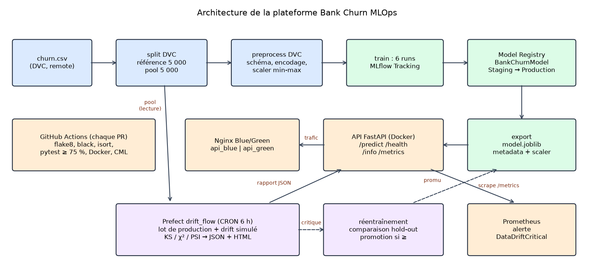

Code en paquets (`src/data`, `features`, `models`, `api`, `monitoring`), flows dans `pipelines/`,
outils dans `scripts/` ; annotations de type et docstrings ; `flake8`, `black`, `isort` et `mypy`
sans erreur (contrôlés le 21/10 sur le commit `07e83c6`).

## 4. Expérimentation et gouvernance avec MLflow

Tracking du TP3 : backend **SQLite**, retenu pour le Registry comme au TP3, artefacts `./mlruns`. Trois
algorithmes × (*baseline*, *tuned*) ; chaque run enregistre hyperparamètres, 5 métriques, tags,
matrice de confusion, ROC, signature et exemple d'entrée.

| Run (test : 1 000 clients, seuil 0,5) | Accuracy | Précision | Rappel | F1 | ROC-AUC |
|---|---|---|---|---|---|
| LogReg-Baseline | 0,804 | 0,556 | 0,196 | 0,290 | 0,758 |
| LogReg-Tuned | 0,703 | 0,379 | 0,711 | 0,494 | 0,760 |
| RandomForest-Baseline | 0,864 | 0,833 | 0,417 | 0,556 | 0,854 |
| **RandomForest-Tuned (champion)** | 0,836 | 0,582 | **0,696** | **0,634** | **0,868** |
| XGBoost-Baseline | 0,869 | 0,783 | 0,495 | 0,607 | 0,865 |
| XGBoost-Tuned | 0,828 | 0,565 | 0,686 | 0,620 | 0,860 |

**Règle du champion** : meilleur ROC-AUC (`models.champion_metric`), indépendant du seuil. Les
métriques du modèle servi ont été recalculées le 21/10 (matrice 694 VN, 102 FP, 62 FN, 142 VP).
**Bilan :** ROC-AUC, F1 et précision (0,582 ≥ 0,50) atteints, **rappel 0,696 < 0,70** (IC95 de
Wilson [0,63 ; 0,76] sur 204 départs : l'écart à 0,70 n'est pas significatif, mais l'objectif
n'est pas atteint). Abaisser
le seuil exigerait un jeu de validation. Le champion est choisi sur le jeu de test, faute de jeu
de validation : ses scores sont légèrement optimistes, et l'écart avec XGBoost-Baseline (0,003)
est trop faible pour départager les deux modèles (non testé statistiquement).

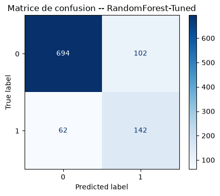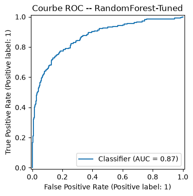

**Historique du Registry.** v1 (entraînement initial), v2 (run Prefect `training-weekly`, même
modèle), **v3 (XGBoost-Baseline promu après drift, §9)**, v4 et v5 (réentraînements sur la
référence, modèle identique à v1). La v3 a été archivée par un entraînement standard qui, **avant
la PR #11**, promouvait son champion sans le comparer au modèle en service. Ce défaut est
**corrigé** depuis la fusion de la PR #11 (§5). La v5 a été conservée (voir la comparaison
ci-dessous).

**État au dernier contrôle** (22/10/2026 08:22, lecture seule de `mlflow.db`) : v1 à v4
*Archived*, **v5 en Production, alias `champion` sur v5**, aucune v6.

**Comparaison des versions — métriques enregistrées dans MLflow** (seuil 0,5, lues dans
`mlflow.db` en lecture seule le 22/10/2026) :

| Version | Jeu d'évaluation du run | ROC-AUC | Recall | Precision | F1-score | Statut |
|---|---|---:|---:|---:|---:|---|
| V1 | 1 000 clients de test de la référence | 0,868 | 0,6961 | 0,582 | 0,6339 | Archived |
| V2 | 1 000 clients de test de la référence | 0,868 | 0,6961 | 0,582 | 0,6339 | Archived |
| V3 | hold-out de 400 lignes, drift simulé | 0,8457 | 0,6098 | 0,5435 | 0,5747 | Archived |
| V4 | 1 000 clients de test de la référence | 0,868 | 0,6961 | 0,582 | 0,6339 | Archived |
| V5 | 1 000 clients de test de la référence | 0,868 | 0,6961 | 0,582 | 0,6339 | Production — champion |

V1, V2, V4 et V5 ont été évaluées sur les mêmes 1 000 clients de référence ; V3 l'a été sur un
jeu distinct de 400 lignes issu de la simulation de dérive. **Ces deux groupes de résultats ne
sont donc pas directement comparables.** V1, V2, V4 et V5 sont le même modèle
(RandomForest-Tuned, 4 000 clients d'entraînement) enregistré quatre fois : l'identité de leurs
prédictions provient d'un contrôle local du 21/10/2026 et n'a pas été recalculée lors du dernier
audit. V3 ne peut pas non plus être évaluée équitablement sur les 1 000 clients de test : elle a
été entraînée sur toute la référence, qui les contient.

**Comparaison sur un jeu commun** (contrôle local du 21/10/2026, résultats déjà enregistrés et
non recalculés pour ce rapport) : 3 000 clients du pool de production, non utilisés par les
deux modèles (aucun client commun avec la référence ni avec le lot d'entraînement de V3), sans
drift, seuil 0,5.

| Modèle | ROC-AUC | Recall | Precision | F1-score | Brier score |
|---|---:|---:|---:|---:|---:|
| V5 — champion | 0,8623 | 0,712 | 0,548 | 0,620 | 0,140 |
| V3 — candidat | 0,8621 | 0,455 | 0,798 | 0,579 | 0,106 |

Les ROC-AUC sont pratiquement identiques (écart −0,0003, IC95 par client [−0,008 ; +0,008]) :
les deux modèles classent les clients aussi bien. Au seuil 0,5, **V5 a un rappel nettement
supérieur** (71 % des départs détectés contre 46 %) et un meilleur F1-score ; **V3 a une meilleure
précision et un meilleur Brier score** (probabilités mieux calibrées). V5 n'est donc pas
meilleure sur toutes les métriques ; elle est retenue parce qu'elle satisfait la règle de
promotion (§5) et le KPI de rappel sur ce jeu.

<figure>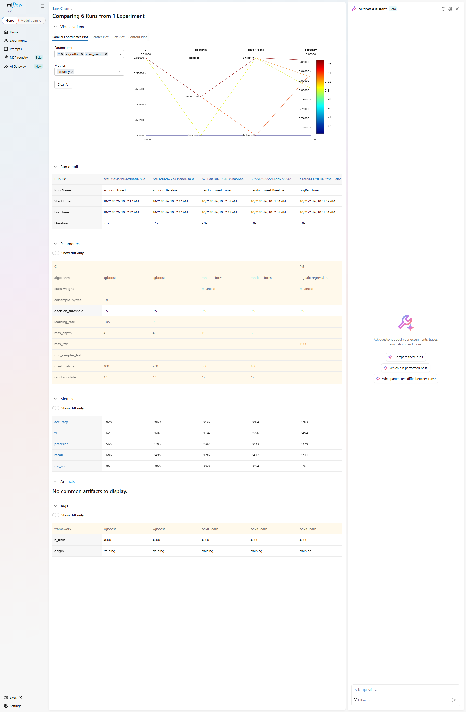<figcaption>Historique (21/10, avant PR #11) — comparaison des runs ; 5 des 6 runs visibles (LogReg-Baseline hors cadre).</figcaption></figure>
<figure>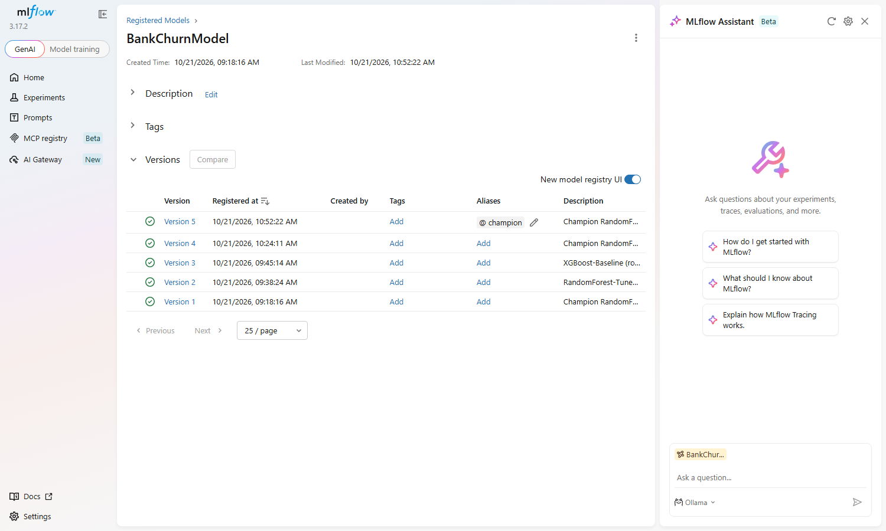<figcaption>Historique (21/10 13:52, avant PR #11) — 5 versions, alias <code>champion</code> sur v5.</figcaption></figure>

## 5. Règle de promotion (PR #11)

Tous les chemins d'entraînement appliquent désormais la même décision
(`src/models/promotion.py`, seuils dans `configs/config.yaml`) : l'étape DVC `train`
(`run_training`), le flow planifié `training_flow` et le réentraînement après drift. Le candidat
et le modèle en service sont évalués **sur les mêmes clients** ; le modèle en service est encodé
avec **son** scaler, **son** ordre de colonnes et **son** seuil de décision.

| Contexte | Clients de comparaison |
|---|---|
| Entraînement planifié et étape DVC `train` | les 1 000 clients de test de la référence |
| Réentraînement après drift | le hold-out de production (400 clients), jamais vu par les deux modèles |

Le candidat n'est promu que si **toutes** les conditions sont réunies :

1. `ROC-AUC_candidat >= ROC-AUC_champion + min_improvement` ;
2. `Recall_candidat >= Recall_champion - max_recall_drop` (rappel au seuil de décision) ;
3. si `recall_floor` est défini, rappel du candidat ≥ `recall_floor` (actuellement désactivé).

Dans la configuration actuelle, `min_improvement = 0.0` et `max_recall_drop = 0.0` : le candidat
ne doit dégrader **ni le ROC-AUC ni le rappel** du champion. La précision n'intervient pas dans
la décision : aucun `precision_floor` n'est implémenté (le KPI de précision ≥ 0,50 est suivi dans
ce rapport, pas par la règle).

**Refus « au moindre doute »** (raison `evaluation_failed`) : métrique du candidat ou du modèle en
service absente, NaN ou infinie ; modèle en service illisible ou impossible à évaluer. **Bundle
manquant** : si le Registry déclare une version en Production alors que `models/` est incomplet,
la décision est `current_bundle_missing` et il n'y a pas de promotion (un bundle absent n'est
traité comme un premier déploiement que si aucune version n'est en Production).

**Conséquences d'un refus.** Le bundle `models/` n'est exporté **qu'en cas de promotion** : un
candidat refusé ne remplace ni le modèle en Production (V5) ni l'alias `champion`, et `models/`
reste inchangé. Entraînement planifié : la version est enregistrée et reste en *Staging*, avec la
raison du refus. Après drift : le candidat n'est pas ajouté au Registry, mais ses runs et
artefacts MLflow sont conservés.

**Seuils actuels et leur effet.** `min_improvement = 0.0` (dans `models.promotion` pour
l'entraînement planifié, dans `prefect` pour le drift) et `max_recall_drop = 0.0` signifient
« au moins aussi bon » : **une égalité suffit à promouvoir**. C'est un choix de conception (le
modèle le plus récent est retenu à performance égale), pas une erreur. Son effet pratique : un
réentraînement sur les mêmes données et la même graine produit un modèle identique, qui serait
enregistré comme nouvelle version (v6) et promu. C'est pourquoi les déploiements Prefect ont été
mis en pause (§8) en attendant une décision. Un gain minimal strictement positif changerait ce
comportement ; la configuration n'a pas été modifiée.

**Biais connu, assumé.** Il concerne la comparaison faite lors d'un **entraînement planifié**,
quand le modèle servi a déjà été réentraîné après une dérive : ce modèle a vu les clients de test
de la référence, son score y est donc optimiste, ce qui favorise le modèle en place (choix
prudent).

**Exemple : pourquoi V3 ne serait pas promue avec la règle actuelle.** V3 a été promue le 21/10
par l'ancienne règle (ROC-AUC seul, §9), puis archivée ; elle n'a pas été restaurée. Comparée à V5
sur le jeu commun de 3 000 clients (§4), son ROC-AUC est légèrement inférieur (0,8621 contre
0,8623, écart non significatif) et son rappel nettement inférieur (0,455 contre 0,712) : les deux
conditions échouent. Sur les scénarios de dérive simulée, son ROC-AUC peut être supérieur
(0,8457 contre 0,8067 sur le hold-out de 400 lignes ; 0,8535 contre 0,8100 sur 1 745 clients du
pool dérivé), mais son rappel reste inférieur (0,610 contre 0,854 ; 0,629 contre 0,851) : la
condition sur le rappel échoue (contrôles locaux du 21/10). Sa meilleure précision ne compte pas,
puisque la précision ne fait pas partie de la règle.

## 6. Microservice d'inférence et conteneurisation

API FastAPI du TP4 : `ModelService` (`load`, `is_ready`, `predict_single`, `predict_batch`)
chargé une fois par le `lifespan` ; schémas **Pydantic v2** (`Literal`, bornes `ge`/`le`
synchronisées avec le contrat, vérifié par un test) ; le prétraitement réutilise
`encode_features()` et le scaler livré avec le modèle.

| Endpoint | Comportement vérifié (requêtes réelles du 21/10, modèle v5) |
|---|---|
| `GET /health` | 200 et version servie ; 503 si le modèle manque (test) |
| `GET /info` | version, algorithme, métriques, variables |
| `POST /predict` | 200 ; **422** pour `Geography="Italy"` ou `Age=12` |
| `POST /predict/batch` | 1 à 1 000 clients ; 1 001 → 422 (test) |
| `GET /metrics` | compteurs, latence, version, drift |

**Latence** (21/10, 200 requêtes HTTP séquentielles après 10 de chauffe, aller-retour local
complet) : **p50 13,6 ms, p95 42,1 ms, max 63,5 ms**, aucune > 150 ms. Mesure locale (boucle
réseau), non représentative d'un réseau réel. Le champ `churn_probability` n'est pas calibré :
la pondération des classes le surestime (moyenne prédite 0,36 pour un taux réel de 0,20).

Le `Dockerfile` est **multi-stage** (`python:3.11-slim`), exécuté sous **`appuser` (UID 1000)**
avec `HEALTHCHECK` ; aucune donnée ni secret n'est copié (`.dockerignore`). L'image mesurée le
21/10 fait **767 Mo** (scikit-learn, SciPy, XGBoost et pandas ; `xgboost-cpu` évite les
bibliothèques CUDA). Lancées avec Docker Compose, les deux API étaient *healthy* et répondaient
via Nginx (pile isolée, modèle v5).

<figure>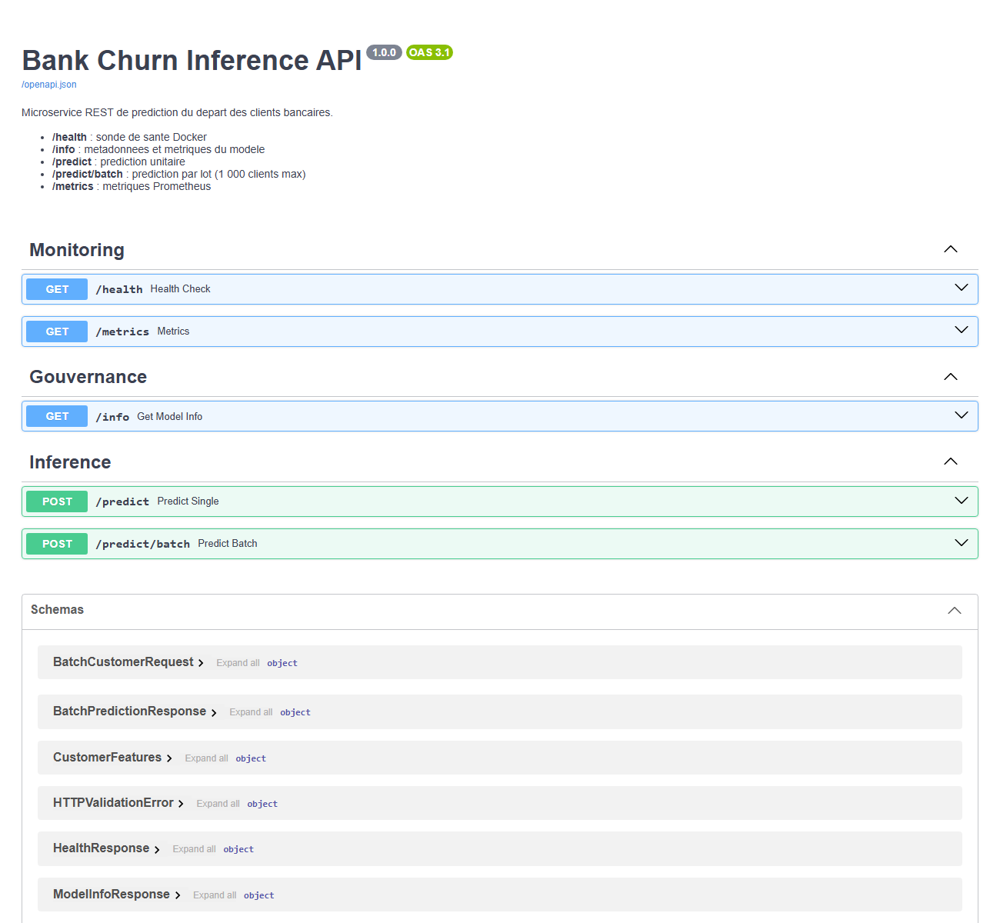<figcaption>Historique (21/10) — Swagger de l'API ; réponses 200/422 dans le fichier texte des requêtes réelles.</figcaption></figure>
<figure>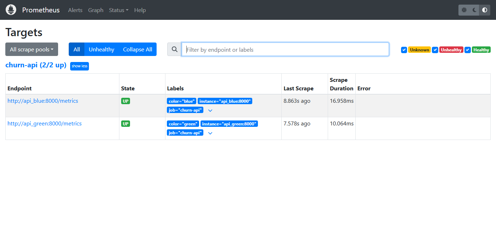<figcaption>Historique (21/10, pile isolée) — les deux conteneurs API sont UP.</figcaption></figure>

## 7. Intégration continue, rapport CML et tests

Le workflow GitHub Actions contient **lint-test** (flake8, black, isort, pytest
`--cov-fail-under=75`), **docker** (build + vérification de l'UID 1000) et **cml-report** sur les
Pull Requests, sans dépendre de DVC, S3, `churn.csv` ni d'un serveur MLflow. Le CML s'entraîne sur
3 000 lignes **synthétiques** (ROC-AUC ≈ 0,68) : c'est un contrôle de non-régression du code, pas
la performance réelle.

**CI de la correction** (lue via l'API GitHub le 21/10) : PR #11 (commit `07e83c6`) — lint-test,
docker et rapport CML réussis ; push sur `main` après fusion (`eb8ee7a`) — lint-test et docker
réussis, CML sauté (normal hors PR).

**Tests locaux : 178 réussis, 0 échec, 0 ignoré ; couverture 95,80 %** (`src` + `pipelines`).
Résultat obtenu le 21/10 sur le **commit de correction `07e83c6`** (Python 3.12, bases MLflow,
sorties et Prefect isolés ; l'état réel a été vérifié identique avant et après). Le merge commit
`eb8ee7a` a exactement la même arborescence, mais la suite locale n'a pas été relancée dessus.

| Fichiers de tests | Tests | Contenu |
|---|---|---|
| `test_data`, `test_features` | 36 | ingestion, split, schéma, encodage |
| `test_drift`, `test_simulator`, `test_dashboard` | 43 | PSI, KS, χ², simulateur, Evidently |
| `test_models` | 27 | métriques, champion, runs, Registry, refus de promotion |
| `test_promotion` | 17 | règle de promotion et cas limites (métriques invalides, bundle manquant) |
| `test_api` | 26 | endpoints, 422, 503, limites du batch, seuils de risque |
| `test_flows` | 13 | flows Prefect, promotion après drift, lot sans labels |
| `test_monitoring_deploy`, `test_cml_report` | 16 | `/metrics`, Blue/Green, CML |

<figure>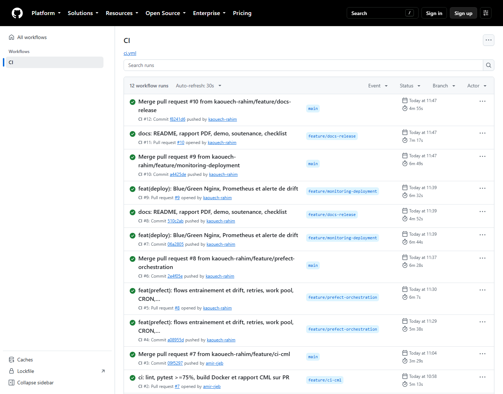<figcaption>Historique (21/10, avant PR #11) — 12 premiers runs CI, tous verts.</figcaption></figure>

## 8. Orchestration avec Prefect 3

Flows à `@task` atomiques ; les tâches d'entrée/sortie ont **2 retries espacés de 5 s**.

- `training_flow` : `ingestion → validation-schema → pretraitement → entrainement → evaluation →
  comparaison-modele-actuel → enregistrement-registry → [si promu] export-modele`.
- `drift_flow` : `ingestion (référence, pool) → lot-de-production → detection-drift →
  rapports-drift → [si critique et labels présents] validation-schema → pretraitement-reentrainement
  → entrainement → evaluation → score-modele-actuel → [si promu] enregistrement-registry →
  export-modele`.

`prefect.yaml` déclare deux déploiements sur le work pool **`churn-pool`** : `training-weekly`
(lundi 03:00) et `drift-daily` (06:00). Le 21/10, avant la PR #11, un run de `training-weekly`
(ancienne version du flow, 7 tâches) a été exécuté par un worker, et un run de drift avec
réentraînement a produit la v3. Version utilisée : Prefect 3.9.0.

**Mise en pause.** Pour éviter qu'une reprise du worker ne crée une v6 identique à la v5 (§5), les
deux déploiements ont été mis en pause le 21/10 à 20:07 via l'API Prefect (aucun flow lancé).
Au dernier contrôle, les deux déploiements étaient en pause et aucun nouveau run n'avait été
créé (22/10/2026 08:22, lecture seule de la base Prefect). Les réactiver est une décision à
prendre (§11).

<figure>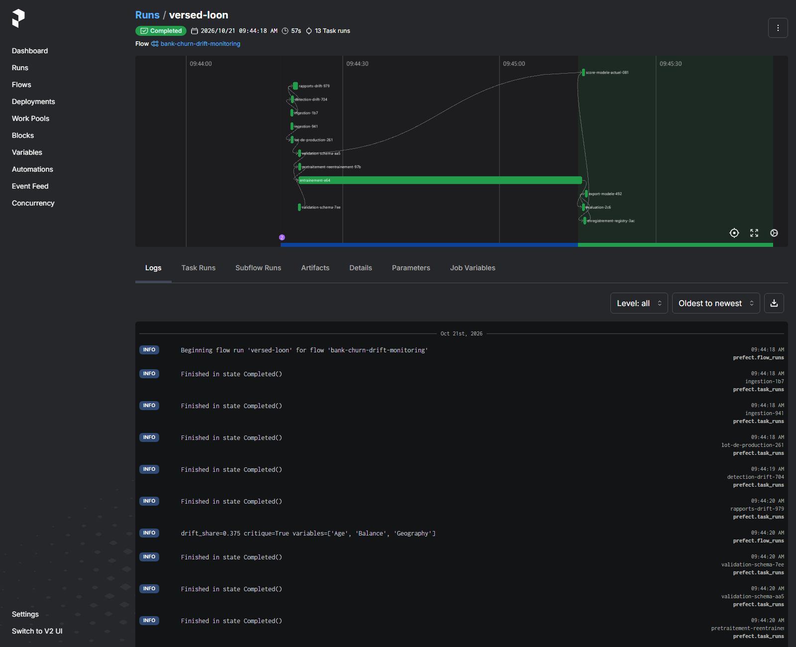<figcaption>Historique (run du 21/10, avant PR #11) — DAG du drift avec réentraînement (13 tâches), heures locales.</figcaption></figure>
<figure>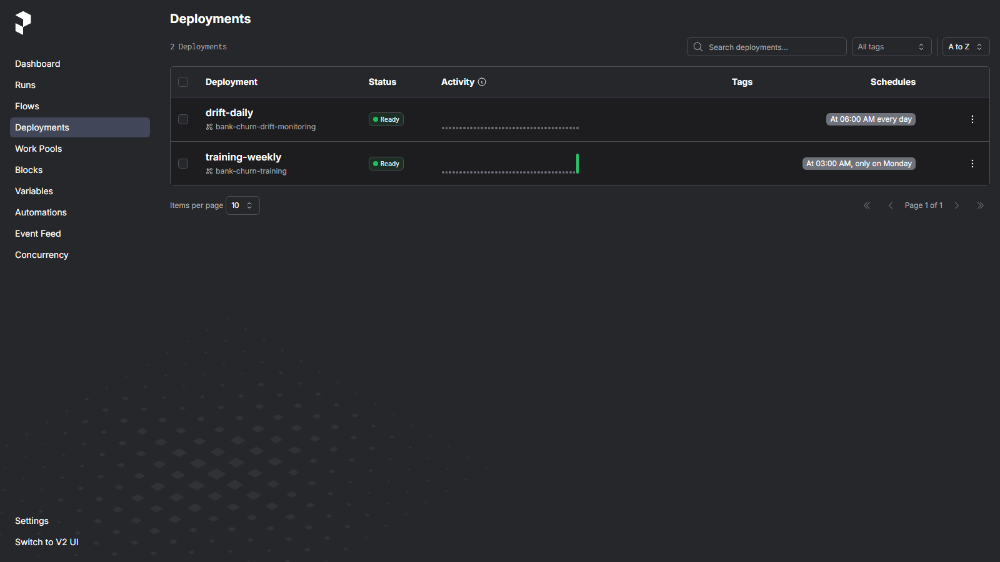<figcaption>Historique (21/10 13:53) — déploiements et CRON, alors actifs ; ils ont été mis en pause depuis.</figcaption></figure>

## 9. Surveillance du drift et boucle de rétroaction

**Méthode.** 8 variables ; test de **Kolmogorov-Smirnov** (numériques) ou **χ²**
(catégorielles), et **PSI** = Σ (p_cur − p_ref) × ln(p_cur / p_ref) sur 10 quantiles de la
référence. Une variable est en drift si p < 0,05 **et** PSI ≥ 0,10 ; le drift est critique si au
moins 30 % des variables dérivent. Scénario `strong` : âge + 8 ans, soldes × 1,3, Allemagne
portée à 50 %, appliqués à une copie en mémoire.

| Variable (lot de 2 000, graine 42) | Test | Stat. | p-value | PSI | Drift |
|---|---|---|---|---|---|
| Age | KS | 0,372 | 2·10⁻¹⁷⁶ | 0,864 | **oui** |
| Balance | KS | 0,383 | 2·10⁻¹⁸⁷ | 0,792 | **oui** |
| Geography | χ² | 511,8 | 7·10⁻¹¹² | 0,344 | **oui** |
| EstimatedSalary | KS | 0,047 | 0,003 | 0,013 | non |

`strong` → **drift_share = 0,375** (3/8, critique) ; `none` → 0,000, et aucune alerte sur 30
graines (recalcul du 21/10). `EstimatedSalary` illustre le double critère. Le dashboard Evidently
(pool complet) désigne les mêmes 3 variables avec son propre calcul du PSI. Le rapport JSON
alimente `/metrics` ; l'alerte **`DataDriftCritical` est passée en *firing*** dans Prometheus
(pile isolée, 21/10). Cette alerte informe l'équipe mais ne déclenche rien : le réentraînement
est lancé par `drift_flow` lui-même quand le drift est critique et que le lot contient la cible.

<figure>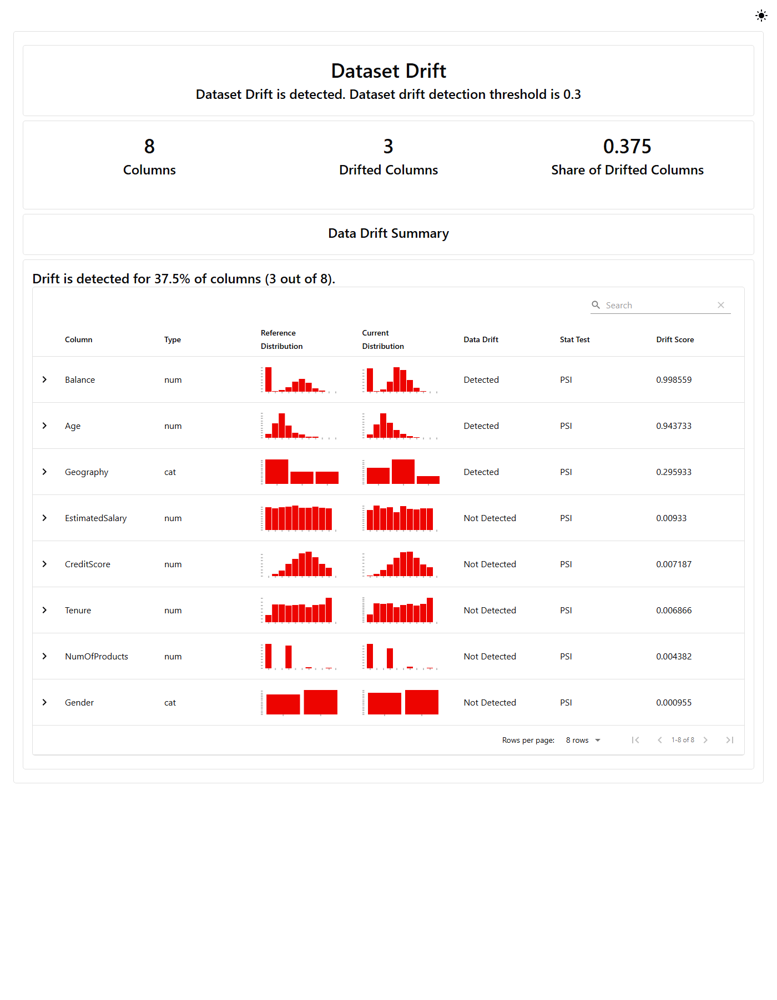<figcaption>Historique (21/10) — Evidently : 3 colonnes sur 8, part 0,375.</figcaption></figure>
<figure>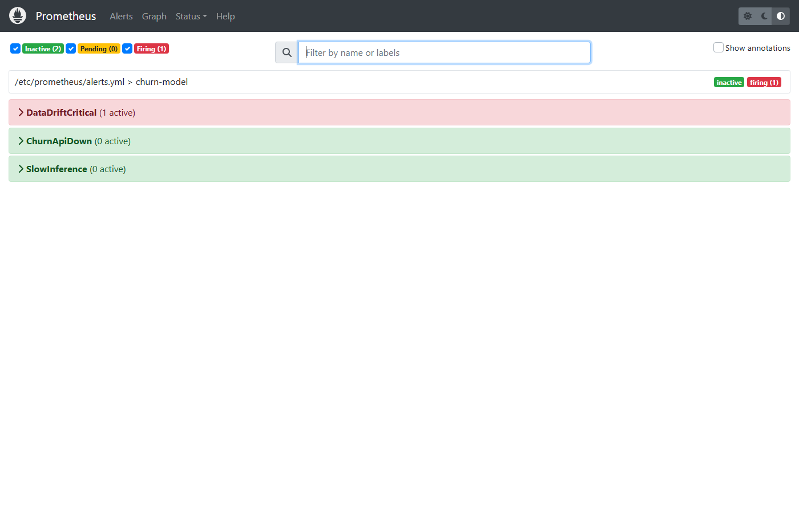<figcaption>Historique (21/10, pile isolée) — alerte <code>DataDriftCritical</code> en firing.</figcaption></figure>

**Réentraînement (run historique du 21/10, avant PR #11).** La première version comparait les
modèles sur un test contenant des lignes déjà vues par l'ancien modèle (score gonflé **0,9115**).
Le lot est désormais coupé **avant** la simulation : 1 600 lignes d'entraînement et un hold-out de
400 lignes sans client commun avec le lot, la référence ou le train initial. Sur ce hold-out,
l'ancien modèle obtenait **0,8067** et XGBoost-Baseline **0,8457** : la règle de l'époque (ROC-AUC
seul) l'a promu en **v3**. **Portée :** le hold-out ne compte que 222 clients distincts, il a aussi
servi à choisir le champion, et le drift est simulé ; un bootstrap par client donne pour le gain
un IC95 de **[−0,006 ; +0,085]**, donc **non significatif**. Avec la règle actuelle, ce candidat
aurait été refusé (rappel 0,610 contre 0,854, §5). Aucun label n'est inventé : un lot sans cible
saute le réentraînement (testé).

**Blue/Green.** Compose démarre `api_blue`, `api_green`, Nginx et Prometheus ;
`switch_traffic.py` déploie sur la couleur inactive, vérifie `/health` et la version, recharge
Nginx et garde l'ancienne couleur pour `--rollback`. Lors de la bascule réelle de l'équipe
(21/10, 10:24), **496 requêtes** en 59 s via Nginx ont toutes reçu **HTTP 200**, la version servie
passant de 3 à 4. La bascule est lancée manuellement (`scripts/switch_traffic.py`) : les flows
ne l'appellent pas. C'est une démonstration locale, pas une preuve de haute disponibilité.

## 10. Répartition du travail

Rôles prévus dans le `SYNOPSIS.md` : Amir Rjeb (lead données et DVC), AbdRahim Kaouech (lead
modélisation et MLflow), Fatma Ayadi (lead serving et CI/CD) ; l'observabilité (drift,
Prometheus, dashboard) était partagée entre les trois.

**Activité vérifiable dans l'historique GitHub** (branche `main`, PR #1 à #11) :

| Membre | Pull Requests ouvertes et fusionnées | Commits sur `main` (hors fusions) |
|---|---|---|
| Amir Rjeb (`amir-rjeb`) | #5 MLflow (entraînement, Registry), #6 API FastAPI et Docker, #7 CI et rapport CML | — |
| AbdRahim Kaouech (`kaouech-rahim`) | #8 orchestration Prefect, #9 Blue/Green, Prometheus et alerte de drift, #10 documentation et rapport | création du dépôt et du `SYNOPSIS.md` (28/09) |
| Fatma Ayadi (`Fatmaayadi`) | #1 squelette, #2 pipeline DVC, #3 détection de drift, #4 nettoyage du README, #11 correction de la promotion | 12 des 13 commits, dont tous les commits de code |

Lecture de ce tableau : chaque PR a été ouverte et fusionnée par le même compte,
sans revue formelle enregistrée. L'auteur d'un commit est le compte qui l'a créé ; il ne prouve
pas à lui seul qui a conçu, écrit ou testé le contenu. Le travail réalisé hors de Git (choix de
conception, tests manuels, démonstration, rédaction) n'apparaît pas dans l'historique.

<b>À confirmer :</b> chaque membre confirme ou complète sa ligne avant la
remise ; ce tableau n'a pas encore été validé par les trois membres.

## 11. Limites et perspectives

- **Rappel 0,696** juste sous l'objectif et sélection sur le test : ajouter un jeu de validation
  pour régler le seuil ; **calibrer** les probabilités avant de les présenter au métier.
- **Gain du réentraînement non significatif** : hold-out plus grand, sans remise, distinct de la
  sélection ; drift simulé, labels conservés.
- **Égalité promue** (`min_improvement = 0.0`) : réactiver Prefect ou relancer `dvc repro`
  créerait une v6 identique à la v5. Décision à prendre : accepter cette v6, fixer un gain minimal
  positif, ou laisser les déploiements en pause.
- **Étape DVC `train` signalée modifiée** depuis la PR #11 et non relancée ; `dvc.lock` décrit
  encore l'état antérieur.
- **Enregistrement et export non atomiques** : si l'export échoue après le passage en Production,
  Registry et `models/` divergent. L'option locale `--no-register` désactive la vérification du
  bundle manquant.
- **Remote DVC** à rétablir (configuration S3 versionnée, identifiants renouvelés).
- **Règle sans critère de précision ni de calibration** : V3 est plus précise et mieux calibrée
  que V5 sur le jeu commun, mais ces critères ne participent pas à la décision ; un
  `precision_floor` pourrait être ajouté après décision.
- **Preuves** : les captures datent d'avant la PR #11 ; les comparaisons de versions reposent sur
  des contrôles locaux du 21/10 non recalculés. Bonus Grafana / Streamlit non réalisés.

## Conclusion

La chaîne demandée pour un trinôme est en place et a été exécutée de bout en bout : données
versionnées, six modèles tracés et gouvernés dans MLflow, API typée et conteneurisée, CI verte avec
rapport CML, flows Prefect planifiés, drift détecté, alerté et suivi d'un réentraînement. La PR #11
a corrigé le principal défaut de conception relevé : un nouveau modèle n'est plus promu que s'il
fait au moins aussi bien que le modèle en service, en ROC-AUC comme en rappel, et jamais en cas de
doute. Les objectifs de ROC-AUC, F1, précision et latence sont atteints ; le rappel (0,696) reste
juste sous 0,70. Cet écart et la portée limitée de la comparaison après drift sont documentés
plutôt que masqués.
